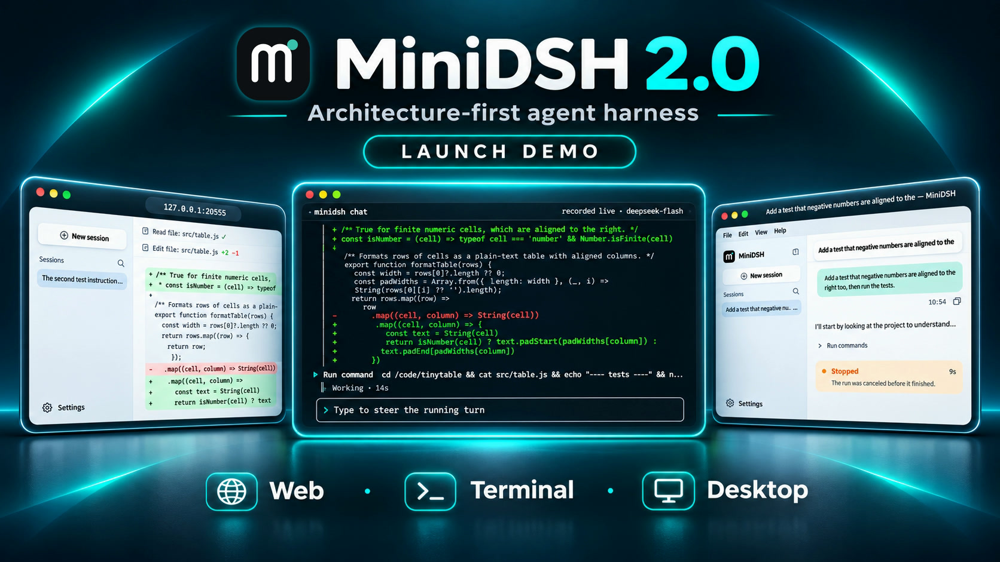

# MiniDSH 2.0: One Runtime, Every Surface

[](https://youtu.be/HpzzGoYtYEc)

The launch film for [MiniDSH](https://github.com/earthwalker17/MiniDSH) 2.0. MiniDSH is the
creator's own small, architecture-first, local-first coding-agent harness. One real coding task,
filmed live: the terminal runs the tools, the same session continues in the browser, the desktop app
keeps its session through a quit, and the one runtime behind them is shown last. About 84 s, 16:9,
English, no voice, an original score in code. On YouTube the film is titled *My MiniDSH 2.0 is
Finally Out: One Runtime, Three Surfaces*.

**Series:** [Product & Launch](../../series/product-launch/SERIES.md) (its first film) · **Number:** 5 · **Engine:** web, 1920×1080 at 60 fps
▶ **Watch:** [youtu.be/HpzzGoYtYEc](https://youtu.be/HpzzGoYtYEc) (published 2026-11-24)

## Status: published
Published on YouTube on 2026-11-24 at 23:44 UTC
([youtu.be/HpzzGoYtYEc](https://youtu.be/HpzzGoYtYEc)) as release v1
([release/v1.json](release/v1.json)): the delivery `minidsh-launch-v1.mp4` (1920×1080 at 60 fps,
42 bars at 120 bpm, 5,040 frames, 1:24.0, H.264 and AAC, BT.709; sha256 `cdc893d58bf0…`, the
post file handed over for the upload) and an archive master with PCM audio (sha256
`584c6e415d39…`), published as the assets of the GitHub release `video/minidsh-launch/v1`.
English, no voice. The film is frozen at that tag and rebuilt only from it (see Reproduce it).

- **Brief and treatment.** [BRIEF.md](BRIEF.md) and [TREATMENT.md](TREATMENT.md). The creator chose
  treatment A on 2026-11-24, built as A′.
- **Made.** The live takes on all three surfaces (2026-11-24); the shared web kit
  (`packages/web-kit`); the pilot look check (light panes, 60 fps); all eight acts and the score;
  two frame-critic rounds; [FACTS.md](FACTS.md), [SCRIPT.md](SCRIPT.md),
  [STORYBOARD.md](STORYBOARD.md). The creator approved the review cut on 2026-11-24, with the
  desktop title changed to "Its own window. Node inside.", and the final on 2026-11-25 (their
  local date).
- **Verified.** The final is frame for frame the approved review cut without its 30-frame test
  card, except the new desktop title (frames 2448–2707). `aiv qa` passes on the delivery and on
  the archive master (−14.0 LUFS, −3.2 dBTP, every hit on its frame, both rests silent, every cut
  on a bar, every reading hold). Colour was verified on the review cut's swatches; the final has
  no test card to measure.
- **Publish kit.** [publish/](publish/): the title and description as uploaded, the X and Product
  Hunt drafts, captions, chapters, the AI-use note and the thumbnail. The thumbnail is the
  creator's ChatGPT image with MiniDSH's real mark put in place of the model's drawing of it
  ([provenance](publish/thumbnail.provenance.json)).

## How it is made
- **Footage.** The real product, recorded live from the published npm package and the published
  installer. The terminal is redrawn from its recorded output. The web and desktop UI are captured
  as stills at three times their pixel density. The tools are in [`capture/`](capture/).
- **Picture.** The web engine, with the WebGL2 kit shared in `packages/web-kit`.
- **Reference.** DeepSeek Harness's Creator Mode film, studied and not copied
  ([note](../../references/dsh-creator-mode-film-2026-11.md)).
- **Method.** Read from op7418/guizang-product-video-skill as a guide only
  ([note](../../references/guizang-product-video-skill.md)).

## Reproduce it
The film is frozen: rebuild it from its release tag, not from `main`.
```sh
git worktree add ../rebuild-minidsh-launch-v1 video/minidsh-launch/v1
cd ../rebuild-minidsh-launch-v1
pnpm install --frozen-lockfile && pnpm aiv doctor --fix   # that tag's toolchain and pinned browser
pnpm aiv audio minidsh-launch
pnpm aiv render minidsh-launch --profile final && pnpm aiv post minidsh-launch --profile final && pnpm aiv qa minidsh-launch --profile final
```
The captures are committed in `assets/`, so a rebuild needs neither MiniDSH nor a key. On the
reference host the frames should match the release's frame hashes; elsewhere compare with SSIM
([PRODUCTION](../../docs/PRODUCTION.md), Rebuild a frozen video).

## Licence
- Code is MIT.
- The film and prose are CC BY 4.0 ([LICENSING](../../docs/LICENSING.md)).
- The thumbnail is AI output with no copyright claimed, with MiniDSH's mark (MIT).
<!-- REUSE-IgnoreStart: third-party rights, not notices for this file -->
- MiniDSH is MIT; its web UI adapts DeepSeek Harness's design tokens and icons (MIT, © DeepSeek).
- MiniDSH is an independent project inspired by DeepSeek Harness, not affiliated with or endorsed by
  DeepSeek.
<!-- REUSE-IgnoreEnd -->
